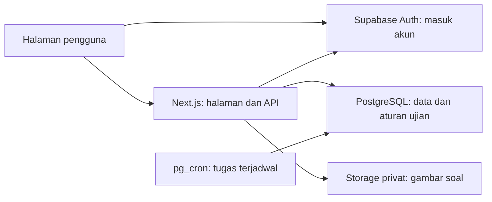

# Socratic

Socratic adalah aplikasi kuis dan ujian daring dengan antarmuka Bahasa Indonesia untuk sekolah atau lembaga pendidikan. Proyek ini berada dalam repository **Safe-Exam-Web**.

Aplikasi mencakup alur dari pendaftaran pengguna, pengelolaan kelas dan soal, pelaksanaan ujian, hingga penilaian dan penerbitan hasil. Teks bawaan untuk siswa menggunakan bahasa sehari-hari, dengan penjelasan aturan sebelum mulai mengerjakan.

**Aturan utama ujian ketat:** saat halaman ujian terdeteksi tidak terlihat, semua jawaban dihapus, termasuk yang sudah tersimpan. Waktu tetap berjalan dan siswa kembali ke soal pertama. Pada kuis, kejadian yang sama dicatat tanpa menghapus jawaban secara otomatis.

## Daftar isi

- [Gambaran proyek](#gambaran-proyek)
- [Peran pengguna](#peran-pengguna)
- [Fitur yang tersedia](#fitur-yang-tersedia)
- [Perbedaan kuis dan ujian ketat](#perbedaan-kuis-dan-ujian-ketat)
- [Alur penggunaan](#alur-penggunaan)
- [Teknologi dan alur data](#teknologi-dan-alur-data)
- [Isi repository](#isi-repository)
- [Halaman utama aplikasi](#halaman-utama-aplikasi)
- [Menjalankan proyek](#menjalankan-proyek)
- [Daftar perintah](#daftar-perintah)
- [Mencoba dengan data demo](#mencoba-dengan-data-demo)
- [Pengujian dan pemeriksaan](#pengujian-dan-pemeriksaan)
- [Batas kemampuan](#batas-kemampuan)
- [Dokumentasi lanjutan](#dokumentasi-lanjutan)

## Gambaran proyek

Socratic membantu pengajar menyiapkan ujian dalam satu tempat dan membantu siswa mengetahui soal yang harus dikerjakan, sisa waktu, serta apakah jawabannya sudah tersimpan. Pengawas dapat melihat perkembangan pengerjaan dan meninjau kejadian selama ujian.

Cakupan proyek saat ini adalah pengelolaan ujian untuk satu sekolah atau lembaga. Data pengguna, kelas, soal, pengerjaan, dan hasil disimpan pada proyek Supabase yang terhubung. Gambar soal disimpan secara privat.

Runtime aplikasi menggunakan Supabase hosted, yaitu layanan Supabase yang diakses melalui internet. Menjalankan aplikasi tidak memerlukan Docker, PostgreSQL lokal, atau server database tambahan di komputer pengembang.

## Peran pengguna

| Peran | Kemampuan utama |
| --- | --- |
| Admin | Mendaftarkan akun dan menentukan peran, mengaktifkan atau menonaktifkan akun, mengelola kelas/soal/ujian, menugaskan pengawas, mengatur penyimpanan data, serta melihat kesehatan layanan dan riwayat tindakan. |
| Pengajar atau pengawas | Pengajar membuat kelas, soal, dan ujian miliknya. Pengajar yang ditugaskan pada suatu ujian dapat memantau, menilai, dan melakukan tindakan pengawasan sesuai izin ujian tersebut. |
| Siswa | Melihat ujian yang ditugaskan, membaca aturan, mengerjakan dan melanjutkan ujian, mengirim jawaban, serta melihat bukti pengiriman dan hasil yang sudah diterbitkan. |

Pengawas menggunakan peran pengajar dengan penugasan pada ujian tertentu; tidak ada peran akun keempat yang terpisah. Penugasan sebagai pengawas tidak otomatis memberikan hak menghapus soal, kelas, atau draft milik pengajar lain.

Akun harus terdaftar dan aktif. Berhasil masuk dengan Google atau email tidak otomatis memberikan akses ke semua ujian.

## Fitur yang tersedia

### Akun dan akses

- Masuk melalui email dan kata sandi atau akun Google, sesuai layanan masuk yang diaktifkan lembaga.
- Pendaftaran menggunakan email yang sudah diizinkan melalui undangan aplikasi, atau link undangan kelas yang masih berlaku.
- Konfirmasi email dan permintaan tautan untuk mengganti kata sandi.
- Pengaturan peran dan status aktif akun oleh admin.
- Pemeriksaan akses pada sistem, sehingga mengganti alamat halaman atau menyembunyikan tombol bukan cara untuk memperoleh hak tambahan.

Undangan aplikasi berarti pemberian izin akses. Menambahkan email ke daftar undangan tidak otomatis mengirim email undangan.

### Kelas dan peserta

- Membuat dan memperbarui kelas berdasarkan daftar email siswa.
- Mengundang murid melalui link kelas tanpa memasukkan email satu per satu. Pada **Kelas & peserta**, buka kelas yang sudah disimpan, lalu **Buat link undangan** dan **Salin link**. Bagikan link kepada murid; setelah daftar/login dan verifikasi email, murid otomatis bergabung sebagai peserta.
- Link berlaku 1–30 hari (default 7 hari), dengan batas 1–1.000 peserta baru (default 40). Pengajar pemilik kelas atau admin dapat mengganti atau menonaktifkannya. Mengganti link langsung membatalkan link lama; anggota yang sudah bergabung tetap tersimpan. Link hanya ditampilkan saat dibuat, sehingga perlu disalin saat itu.
- Menggabungkan anggota kelas dengan peserta tambahan pada suatu ujian.
- Menambahkan peserta tanpa harus memasukkan mereka ke kelas terlebih dahulu.
- Menugaskan pengajar sebagai pengawas ujian melalui akun admin.
- Memberikan izin mengerjakan tanpa layar penuh untuk peserta tertentu, disertai alasan. Aturan penghapusan jawaban pada ujian ketat tetap berlaku.

### Bank soal

- Soal pilihan ganda dengan 2–6 pilihan dan satu jawaban benar.
- Soal esai berupa jawaban teks.
- Pertanyaan, bobot nilai, tag, gambar opsional, dan pedoman penilaian esai.
- Unggah gambar JPEG, PNG, atau WebP sampai 2 MB.
- Penyuntingan dan pencatatan versi soal.
- Pengarsipan soal agar tidak dipilih untuk ujian baru.
- Penghapusan soal yang tidak lagi digunakan, dengan pembatasan sesuai kepemilikan dan hubungan data.

Perubahan bank soal tidak mengubah salinan soal pada ujian yang sudah diterbitkan.

### Impor soal dari dokumen

Pengajar dapat mengimpor soal pilihan ganda dan esai dari **TXT, Markdown, atau PDF yang berisi teks**, kemudian:

1. Melihat hasil pembacaan dokumen.
2. Memperbaiki teks di editor.
3. Memeriksa kesalahan per soal.
4. Memilih soal yang ingin dimasukkan.
5. Menyimpan pilihan ke bank soal.

Batas impor adalah 2 MB per berkas, 200.000 karakter teks, 100 soal, dan 50 halaman untuk PDF. Dokumen mengikuti format bernomor dengan pilihan, kunci, bobot, tag, atau pedoman esai.

PDF hasil foto atau pindai perlu diubah menjadi teks terlebih dahulu. Gambar dan tata letak dokumen tidak ikut diimpor. Dokumen asli tidak disimpan; yang disimpan adalah soal yang dipilih. Fitur ini membaca format terstruktur dan tidak membuat atau menebak soal menggunakan AI.

Lihat [format impor dan contoh lengkap](docs/QUESTION_IMPORT.md), [contoh TXT](public/templates/soal.txt), dan [contoh Markdown](public/templates/soal.md).

### Penyusunan dan penerbitan ujian

- Judul, petunjuk pengajar, kelas, peserta tambahan, serta jadwal buka dan tutup.
- Pilihan kuis atau ujian ketat.
- Durasi 1–480 menit dan maksimal 100 soal per ujian.
- Pengaturan nilai minimum lulus dan pengurangan poin untuk jawaban pilihan ganda yang salah.
- Pengacakan urutan soal dan pilihan jawaban per peserta.
- Pratinjau draft tanpa memulai pengerjaan siswa atau menampilkan kunci.
- Penguncian isi dan aturan setelah ujian diterbitkan.
- Penutupan akses untuk memulai ujian baru; pengerjaan yang sudah aktif tetap mengikuti batas waktunya.

Saat siswa mulai, sistem menyimpan salinan isi ujian dan susunan soal/pilihannya. Melanjutkan pengerjaan tidak mengacak ulang susunan tersebut.

### Pengerjaan oleh siswa

- Daftar ujian beserta jadwal dan status pengerjaan.
- Halaman aturan, pemeriksaan sambungan, layar penuh, dan perkiraan waktu sebelum mulai.
- Persetujuan terhadap aturan dan aktivitas yang dicatat.
- Navigasi antarsoal, daftar nomor soal, jumlah terjawab, pengosongan jawaban, dan tanda untuk dicek lagi.
- Jawaban esai sampai 20.000 karakter per soal.
- Penyimpanan otomatis dan keterangan apakah perubahan sudah diterima sistem.
- Antrean sementara di perangkat ketika sambungan terganggu, untuk dicoba kembali sebelum waktu habis.
- Melanjutkan pengerjaan dengan jawaban yang masih sah dan batas waktu yang sama.
- Konfirmasi sebelum mengirim, termasuk jumlah soal terjawab dan kosong.
- Bukti pengiriman setelah ujian selesai.

Tampilan menyesuaikan komputer, tablet, dan ponsel. Kesesuaian perangkat untuk ujian ketat tetap perlu diperiksa, terutama dukungan layar penuh dan perilaku saat berpindah aplikasi.

### Waktu dan perlindungan jawaban

- Batas waktu ditentukan sistem, sehingga mengubah jam perangkat tidak menambah waktu ujian.
- Waktu awal mengikuti durasi ujian atau sisa jadwal, mana yang lebih singkat.
- Waktu tidak berhenti ketika internet terputus, halaman ditutup, atau perangkat tidak digunakan.
- Sistem menolak perubahan jawaban setelah waktu habis atau ujian selesai.
- Pengiriman ulang suatu perubahan tidak menggandakan operasi yang sama.
- Permintaan jawaban dari sebelum penghapusan tidak dapat mengembalikan jawaban lama.
- Satu pengerjaan hanya mempunyai satu halaman/sesi yang diizinkan menulis jawaban.
- Perpindahan pada ujian ketat memerlukan persetujuan pengawas.
- Penyelesaian ujian yang melewati batas waktu diproses oleh pemeriksaan sistem dan tugas terjadwal di Supabase.

Penyimpanan sementara di perangkat membantu pemulihan gangguan. Jawaban baru dianggap masuk penilaian setelah diterima sistem sebelum batas waktu.

### Pemantauan dan tindakan pengawas

Halaman pemantauan menampilkan peserta, jumlah jawaban, status pengerjaan, kabar terakhir dari perangkat, jumlah penghapusan jawaban, permintaan perpindahan, dan urutan kejadian. Data diperbarui berkala setiap 10 detik saat halaman pemantauan terlihat.

Pengawas dapat:

- Mencatat hasil peninjauan dan alasan.
- Menambah waktu 1–60 menit per tindakan pada pengerjaan yang masih aktif.
- Menyetujui perpindahan halaman atau perangkat.
- Menghentikan ujian dan menyelesaikan jawaban yang sudah diterima.
- Memberi kesempatan mengulang setelah pengerjaan selesai, selama pembahasan belum diterbitkan.

Hasil peninjauan mencakup perlu ditinjau, tidak relevan/salah deteksi, pelanggaran dikonfirmasi, belum dapat disimpulkan, atau hasil dinyatakan tidak berlaku. Catatan peninjauan tidak memulihkan jawaban yang sudah dihapus.

### Penilaian dan hasil

- Pilihan ganda dinilai otomatis oleh sistem.
- Jawaban benar mendapat poin sesuai bobot; jawaban salah dapat dikenai pengurangan; jawaban kosong mendapat nol.
- Esai dinilai pengajar menggunakan pedoman dari salinan ujian yang dikerjakan siswa.
- Pengajar mengisi skor dan komentar per esai, lalu menyimpan seluruh penilaian sekaligus melalui finalisasi. Belum ada penyimpanan draft koreksi; skor yang sudah difinalisasi tidak dapat diedit melalui alur ini.
- Nilai akhir menggabungkan poin pilihan ganda dan esai pada skala 0–100.
- Selama esai belum selesai dinilai, hasil menampilkan status menunggu, bukan nilai nol.
- Nilai dan pembahasan diterbitkan secara terpisah.
- Siswa dapat melihat nilai, status lulus, jumlah pilihan ganda benar/salah, soal kosong, serta skor dan komentar esai sesuai penerbitan hasil.
- Rekap hasil dapat diekspor ke CSV.

Contoh: satu soal pilihan ganda berbobot 1 dijawab benar dan satu esai berbobot 4 mendapat 3 poin. Nilai akhir adalah `(1 + 3) / (1 + 4) × 100 = 80`. Pengurangan poin hanya berlaku pada pilihan ganda yang salah; nilai akhir dibatasi 0–100.

Lihat [penilaian esai dan penerbitan hasil](docs/ESSAY.md).

### Pengelolaan data dan layanan

- Pengaturan nama lembaga dan lama penyimpanan hasil, catatan aktivitas, serta riwayat tindakan.
- Jadwal dan hasil ditampilkan dalam WIB, yaitu Asia/Jakarta.
- Halaman kesehatan layanan untuk melihat pengerjaan yang belum diselesaikan sistem, antrean tertua, kegagalan simpan/kirim, dan status tugas terjadwal.
- Riwayat tindakan pengelola dan penghapusan jawaban.
- Penghapusan kelas serta draft ujian yang memenuhi syarat.
- Konfirmasi sebelum penghapusan permanen; data yang masih terhubung dengan ujian dilindungi.
- Gambar soal disimpan privat dan hanya diberikan kepada pengguna yang berhak melalui tautan berbatas waktu.

Menghapus kelas tidak menghapus akun siswa. Menghapus draft tidak menghapus bank soal. Ujian yang sudah diterbitkan beserta pengerjaan dan hasilnya tidak dapat dihapus lewat tombol hapus draft. File gambar tidak ikut dibersihkan otomatis saat soal dihapus.

Lihat [aturan penghapusan data](docs/DELETE.md).

## Perbedaan kuis dan ujian ketat

| Hal yang dibandingkan | Kuis | Ujian ketat |
| --- | --- | --- |
| Nama mode dalam kode | `quiz` | `exam` |
| Layar penuh | Tidak wajib. | Diminta sebelum mulai, kecuali pengawas memberi izin tanpa layar penuh. |
| Halaman ujian menjadi tidak terlihat | Kejadian dicatat dan siswa diberi pemberitahuan. | Seluruh jawaban dan tanda pengecekan dihapus, termasuk yang sudah tersimpan; kembali ke soal pertama. |
| Waktu setelah meninggalkan halaman | Tetap berjalan. | Tetap berjalan, tanpa dimulai ulang. |
| Keluar dari layar penuh saja | Tidak memicu penghapusan jawaban. | Dicatat dan diberi pengingat; penghapusan dipicu jika halaman ujian juga menjadi tidak terlihat. |
| Perpindahan halaman/perangkat untuk menulis jawaban | Tidak memerlukan persetujuan pengawas melalui aturan ujian ketat. | Memerlukan persetujuan pengawas. |
| Nilai | Secara bawaan dapat dilihat setelah penilaian lengkap. | Menunggu diterbitkan pengajar dan penilaian lengkap. |
| Pembahasan dan kunci | Diterbitkan terpisah setelah seluruh batas waktu yang dipersyaratkan selesai. | Ketentuan yang sama. |
| Kamera, mikrofon, dan rekaman layar | Tidak digunakan. | Tidak digunakan. |

Membuka halaman lain, berpindah aplikasi, mengecilkan jendela, atau mengunci layar **bisa** membuat halaman ujian tidak terlihat. Perilakunya bergantung pada perangkat dan aplikasi yang digunakan.

**Catatan aktivitas bukan bukti otomatis kecurangan.** Pengawas perlu meninjau kejadian dan kendala siswa. Izin tanpa layar penuh tidak menghapus aturan penghapusan jawaban ketika halaman ujian ketat menjadi tidak terlihat.

## Alur penggunaan

### Admin

1. Menyiapkan Supabase dan akun admin pertama.
2. Mendaftarkan pengajar dan siswa, lalu mengatur peran dan status akun.
3. Menugaskan pengawas pada ujian yang diperlukan.
4. Mengatur lama penyimpanan data dan memeriksa kesehatan layanan.
5. Meninjau riwayat tindakan ketika diperlukan.

### Pengajar dan pengawas

1. Membuat kelas atau menentukan peserta tambahan melalui email.
2. Membuat soal satu per satu atau mengimpor dokumen.
3. Menyusun draft, mengatur jadwal dan aturan, lalu memeriksa pratinjau.
4. Menerbitkan ujian.
5. Memantau pengerjaan dan menangani permintaan atau kendala peserta.
6. Menilai esai setelah pengerjaan selesai.
7. Menerbitkan nilai dan pembahasan pada waktunya, lalu mengunduh rekap.

### Siswa

1. Masuk menggunakan akun yang didaftarkan sekolah atau lembaga.
2. Memilih ujian yang tersedia.
3. Membaca petunjuk, aturan, batas waktu, dan penjelasan aktivitas yang dicatat.
4. Memeriksa perangkat dan menyatakan sudah membaca aturan.
5. Mulai atau lanjutkan pengerjaan; periksa keterangan penyimpanan jawaban.
6. Memeriksa jawaban, lalu mengirim ujian.
7. Menyimpan nomor bukti dan melihat hasil setelah tersedia.

Pemeriksaan sebelum **ujian baru** belum memulai waktu pengerjaan. Jika ujian sudah pernah dimulai, membuka pemeriksaan kembali tidak menghentikan atau mengulang waktunya. Perkiraan sisa waktu mengikuti pengerjaan aktif, termasuk tambahan waktu dari pengawas.

## Teknologi dan alur data

| Bagian | Teknologi dalam proyek | Perannya |
| --- | --- | --- |
| Aplikasi web | Next.js 16.4.2 dengan App Router, React 19.3.1 | Halaman pengguna, pengolahan di sisi aplikasi, dan endpoint API. |
| Bahasa kode | TypeScript 6 | Tipe data dan pemeriksaan kode. |
| Tampilan | Tailwind CSS 4 dan CSS di `src/app/globals.css` | Tata letak, tampilan responsif, dan keadaan antarmuka. |
| Akun | Supabase Auth | Login Google/email, verifikasi email, dan kata sandi. |
| Data | PostgreSQL pada Supabase hosted | Kelas, soal, versi ujian, jawaban, hasil, dan aturan akses/transaksi. |
| Gambar soal | Supabase Storage | Penyimpanan privat dan tautan gambar berbatas waktu. |
| Pekerjaan terjadwal | `pg_cron` pada Supabase | Menyelesaikan ujian kedaluwarsa dan membersihkan data sesuai lama penyimpanan. |
| Pemeriksaan input | Zod | Memeriksa isian dan permintaan sebelum diproses. |
| Pembacaan PDF | `unpdf` | Mengambil teks PDF untuk impor soal. |
| Pemulihan sementara | IndexedDB di perangkat | Menyimpan antrean jawaban dan kejadian yang belum terkirim. |
| Pengujian | Vitest, PGlite, dan Playwright | Memeriksa fungsi, SQL, alur pengguna, dan tampilan. |
| Hosting | Konfigurasi Vercel tersedia | Menyiapkan pemasangan aplikasi Next.js. |

Versi lengkap paket tercatat di [package.json](package.json). Font IBM Plex dan ikon Lucide digunakan untuk antarmuka.



Browser menggunakan kunci publik Supabase untuk autentikasi. Permintaan data aplikasi diperiksa oleh Next.js, lalu diteruskan ke fungsi database melalui kunci khusus server. Hak akses, batas waktu, penyimpanan jawaban, dan penilaian tidak hanya bergantung pada tampilan browser.

Database memakai pembatasan akses per baris atau **RLS**, dan fungsi sensitif dibatasi untuk penggunaan server. Penyimpanan jawaban, penghapusan, pengiriman, dan penilaian menggunakan transaksi agar perubahan yang berkaitan diproses bersama.

Tugas finalisasi pada migrasi dijadwalkan setiap 10 detik dan pembersihan data setiap hari. Itu adalah jadwal tugas, bukan jaminan waktu selesai atau hasil pengukuran kapasitas.

## Isi repository

```text
Safe-Exam-Web/
├── src/
│   ├── app/
│   │   ├── (workspace)/             Halaman siswa, pengajar, dan admin setelah masuk
│   │   ├── api/                     Endpoint data, gambar, dan impor soal
│   │   ├── attempts/                Halaman pengerjaan ujian
│   │   ├── auth/                    Masuk, keluar, konfirmasi, dan ganti kata sandi
│   │   ├── login/                   Halaman masuk
│   │   ├── privacy/                 Data pribadi dan aturan ujian
│   │   ├── setup/                   Panduan penyiapan awal
│   │   └── globals.css              Gaya tampilan bersama
│   ├── components/                  Form, aturan, pengerjaan, pemantauan, dan penilaian
│   ├── lib/                         Tipe data, validasi, API, antrean jawaban, dan impor
│   └── proxy.ts                     Pembaruan sesi masuk dan aturan cache permintaan
├── supabase/
│   └── migrations/                  Skema, fungsi, hak akses, dan tugas database
├── scripts/                         Penyiapan, pemeriksaan hosted, dan data demo
├── tests/
│   ├── e2e/                         Pengujian alur pengguna melalui browser
│   ├── load/                        Skenario uji beban k6
│   └── support/                     Layanan data uji dan alat pemeriksaan tampilan
├── public/
│   ├── templates/                   Contoh dokumen soal TXT dan Markdown
│   └── logo.jpeg                    Logo Socratic
├── docs/                            Panduan fitur, pemasangan, operasi, dan audit
├── .env.example                     Daftar variabel konfigurasi tanpa kredensial
├── package.json                     Paket dan perintah proyek
├── next.config.ts                   Konfigurasi Next.js dan header keamanan
├── playwright.config.ts             Konfigurasi browser dan layanan pengujian
└── vercel.json                      Konfigurasi pemasangan di Vercel
```

Berkas utama untuk memahami perilaku aplikasi:

| Berkas | Isi |
| --- | --- |
| [exam-rules.tsx](src/components/exam-rules.tsx) | Aturan bersama yang ditampilkan pada detail ujian dan halaman aturan. |
| [start-exam.tsx](src/components/start-exam.tsx) | Pemeriksaan sebelum mulai/lanjut, persetujuan, layar penuh, dan perkiraan waktu. |
| [runner.tsx](src/components/runner.tsx) | Soal, jawaban, penyimpanan, timer, penanganan gangguan, penghapusan, dan pengiriman. |
| [monitor.tsx](src/components/monitor.tsx) | Pemantauan peserta dan tindakan pengawas. |
| [grading.tsx](src/components/grading.tsx) | Penilaian esai dan komentar pengajar. |
| [question-import.tsx](src/components/question-import.tsx) | Unggah dokumen, editor, pratinjau, pemilihan, dan penyimpanan impor. |
| [server.ts](src/lib/server.ts) | Pemeriksaan pengguna dan pemanggilan fungsi database. |
| [client.ts](src/lib/client.ts) dan [pending.ts](src/lib/pending.ts) | Permintaan dari browser, identitas halaman aktif, dan antrean penyimpanan sementara. |
| [domain.ts](src/lib/domain.ts) dan [validation.ts](src/lib/validation.ts) | Pesan, perhitungan pendukung, serta aturan validasi permintaan. |
| [Migrasi database](supabase/migrations/) | Aturan akses, salinan ujian, jawaban, penilaian, peninjauan, impor, dan penghapusan data. |

## Halaman utama aplikasi

`[examId]` dan `[attemptId]` pada tabel berarti nomor pengenal ujian atau pengerjaan yang diisi aplikasi.

| Alamat | Kegunaan |
| --- | --- |
| `/login` | Masuk, daftar dengan email terdaftar, dan meminta tautan ganti kata sandi. |
| `/auth/reset-password` | Mengatur kata sandi baru setelah membuka tautan yang sah. |
| `/dashboard` | Daftar ujian siswa. |
| `/exams/[examId]` | Petunjuk, jadwal, penilaian, dan aturan ujian. |
| `/exams/[examId]/check` | Pemeriksaan dan persetujuan sebelum mulai atau melanjutkan. |
| `/attempts/[attemptId]` | Mengerjakan soal. |
| `/results/[attemptId]` | Bukti pengiriman dan hasil sesuai kebijakan penerbitan. |
| `/manage` | Ringkasan pengelolaan untuk pengajar dan admin. |
| `/manage/questions` dan `/manage/questions/import` | Bank soal dan impor dokumen. |
| `/manage/classes` dan `/manage/exams` | Kelas, draft, serta ujian yang dikelola. |
| `/manage/exams/[examId]/participants` | Peserta, penugasan pengawas oleh admin, dan izin tanpa layar penuh. |
| `/manage/exams/[examId]/monitor` | Pemantauan dan peninjauan kejadian. |
| `/manage/exams/[examId]/results` | Rekap, penerbitan hasil, dan ekspor CSV. |
| `/manage/exams/[examId]/grading/[attemptId]` | Penilaian esai satu peserta. |
| `/admin/users`, `/admin/settings`, dan `/admin/audit` | Akun, pengaturan lembaga/kesehatan layanan, dan riwayat tindakan. |
| `/privacy`, `/setup`, dan `/access-pending` | Aturan/data pribadi, panduan awal, dan penjelasan akses yang belum tersedia. |

## Menjalankan proyek

### 1. Prasyarat

- Node.js **24.x**, sesuai batas versi pada `package.json`, dan npm.
- Proyek Supabase hosted dengan akses pengelolaan untuk penyiapan awal.
- Koneksi internet dari aplikasi ke Supabase.
- Layanan masuk email atau Google yang sudah disiapkan sesuai pilihan lembaga.

### 2. Pasang paket dan isi konfigurasi

Jalankan dari root repository. Contoh berikut menggunakan PowerShell:

```powershell
npm ci
if (-not (Test-Path -LiteralPath .env.local)) {
    Copy-Item -LiteralPath .env.example -Destination .env.local
}
```

Jika `.env.local` sudah ada, perbarui berkas tersebut tanpa menimpanya. Isi nilai menggunakan sumber dari proyek Supabase:

| Variabel | Dipakai untuk |
| --- | --- |
| `NEXT_PUBLIC_SUPABASE_URL` | Alamat proyek Supabase. |
| `NEXT_PUBLIC_SUPABASE_PUBLISHABLE_KEY` | Kunci publik untuk alur masuk akun; kunci lama bernama `anon` juga didukung. |
| `SUPABASE_SECRET_KEY` | Kunci khusus server; kunci lama bernama `service_role` juga didukung. |
| `NEXT_PUBLIC_APP_URL` | Alamat aplikasi, misalnya `http://127.0.0.1:3000` saat pengembangan. |
| `BOOTSTRAP_ADMIN_EMAIL` | Email yang akan diberi undangan admin pertama. |
| `SUPABASE_ACCESS_TOKEN` | Token pengelolaan akun Supabase untuk skrip migrasi dan pemeriksaan tertentu. Bukan kunci publik atau kata sandi database. |

Empat variabel pertama dibutuhkan saat menjalankan aplikasi. Email bootstrap dan token pengelolaan hanya diperlukan untuk tugas penyiapan/pengelolaan yang menggunakannya. Token migrasi otomatis adalah Personal Access Token Supabase dengan awalan `sbp_`.

Jangan memberi awalan `NEXT_PUBLIC_` pada kunci khusus server. Berkas `.env`, `.env.local`, dan keluaran rahasia di `.local/` diabaikan Git. Jika `.env` dan `.env.local` sama-sama tersedia, `.env.local` didahulukan. Mulai ulang aplikasi setelah konfigurasi berubah.

### 3. Siapkan database, gambar, dan admin pertama

Untuk proyek Supabase baru dengan token pengelolaan yang sudah diisi:

```powershell
npm run supabase:prepare
npm run supabase:migrate
npm run bootstrap:admin
```

- `supabase:prepare` menyiapkan bucket gambar privat `exam-media`.
- `supabase:migrate` menerapkan berkas SQL yang belum tercatat, secara berurutan dari `supabase/migrations/`. Migrasi juga menyiapkan tugas finalisasi dan pembersihan data.
- `bootstrap:admin` menambahkan izin/undangan admin pertama. Perintah ini tidak membuat kata sandi atau mengirim email secara otomatis.

Daftar migrasi yang sudah diterapkan dicatat di database. Menjalankan ulang perintah migrasi melewati berkas yang sudah tercatat. Panduan rinci tersedia pada [konfigurasi Supabase](docs/SUPABASE.md).

### 4. Siapkan cara masuk akun

Untuk email dan kata sandi:

1. Aktifkan layanan masuk Email pada Supabase.
2. Atur alamat aplikasi dan alamat pengembalian setelah konfirmasi email.
3. Siapkan pengiriman email sesuai kebutuhan sekolah atau lembaga.
4. Buka **Daftar dengan email** menggunakan email admin yang sudah didaftarkan, lalu ikuti konfirmasi akun.
5. Setelah admin masuk, daftarkan akun berikutnya melalui aplikasi.

Alamat pengembalian lokal yang digunakan:

```text
http://127.0.0.1:3000/auth/callback
http://127.0.0.1:3000/auth/callback?next=reset-password
```

Untuk Google, aktifkan layanannya di Supabase dan gunakan alamat pengembalian Google yang ditampilkan oleh proyek Supabase. Kredensial Google dikelola pada pengaturan tersebut, bukan ditambahkan sebagai variabel publik aplikasi.

Lihat [panduan email dan kata sandi](docs/EMAIL_PASSWORD.md) dan [panduan Google](docs/GOOGLE_OAUTH.md). Sebagian panduan mencatat label antarmuka lama; pada antarmuka sekarang gunakan **Daftar dengan email** dan **Lupa kata sandi?**.

### 5. Periksa koneksi dan jalankan aplikasi

```powershell
npm run supabase:check
npm run dev
```

Buka [http://127.0.0.1:3000](http://127.0.0.1:3000). Gunakan alamat yang sama persis dengan `NEXT_PUBLIC_APP_URL`; `localhost`, `127.0.0.1`, dan nomor port yang berbeda dianggap alamat asal yang berbeda.

Untuk menjalankan hasil build:

```powershell
npm run build
npm run start
```

Jika memasang di Vercel, ikuti [panduan Vercel](docs/VERCEL.md). Siapkan empat variabel runtime, URL HTTPS aplikasi, pengaturan pengembalian login, dan lakukan deployment baru setelah mengubah variabel publik. Tugas finalisasi ujian berada di Supabase; tidak perlu menduplikasinya dengan Vercel Cron.

## Daftar perintah

| Perintah | Fungsi |
| --- | --- |
| `npm run dev` | Menjalankan aplikasi pengembangan pada `127.0.0.1`. |
| `npm run build` | Membuat build produksi. |
| `npm run start` | Menjalankan hasil build produksi. |
| `npm run typecheck` | Memeriksa tipe TypeScript tanpa menghasilkan berkas aplikasi. |
| `npm run lint` | Memeriksa kode dengan ESLint. |
| `npm test` | Menjalankan tes fungsi dan database uji. |
| `npm run test:e2e` | Menjalankan pengujian browser dengan layanan uji lokal. |
| `npm run supabase:check` | Memeriksa sambungan, layanan masuk, kunci, RPC inti/optimasi, dan storage privat; gagal bila migrasi wajib belum tersedia. |
| `npm run supabase:prepare` | Menyiapkan penyimpanan gambar privat. |
| `npm run supabase:migrate` | Menerapkan migrasi SQL yang belum tersedia. |
| `npm run bootstrap:admin` | Menambahkan undangan admin pertama. |
| `npm run seed:demo:plan` | Menampilkan rencana dataset demo tanpa membuat data. |
| `npm run seed:demo` | Membuat data dan akun demo pada Supabase yang terhubung. |
| `npm run seed:demo:check` | Memeriksa dataset demo. |
| `npm run seed:demo:clean` | Menampilkan rencana pembersihan demo. Penghapusan baru diterapkan dengan `-- --apply`. |
| `npm run vercel:prepare -- --origin https://domain-sekolah.example` | Menyiapkan berkas konfigurasi Vercel di `.local/`; tidak melakukan deployment. |

Daftar perintah dan kebutuhan nilainya bersumber dari [package.json](package.json) serta [folder scripts](scripts/). Perintah migrasi, pembuatan demo, bootstrap, dan opsi penerapan konfigurasi bekerja pada Supabase yang dipilih oleh environment.

## Mencoba dengan data demo

Untuk mencoba fitur tanpa menyusun semua data dari awal:

```powershell
npm run seed:demo:plan
npm run seed:demo
npm run seed:demo:check
```

Data demo mencakup admin, pengajar/pengawas, siswa dengan beberapa keadaan akun, kelas, soal pilihan ganda/esai, gambar, ujian berbagai kondisi, pengerjaan aktif/selesai, penilaian tertunda, hasil, serta catatan pengawasan.

Kredensial acak dan petunjuk penggunaan tersimpan pada `.local/DEMO-ACCESS.md` dan `.local/demo-accounts.json`. Berkas ini tidak dimasukkan ke Git. Membuka aplikasi tidak otomatis membuat data demo.

Pembuatan demo bekerja pada proyek Supabase yang terhubung, bukan database lokal sementara. Menjalankan seed kembali mempertahankan perubahan data demo yang sudah ada. Baca [panduan data demo](docs/DEMO_DATA.md) untuk isi dataset, syarat token, dan dampak pembersihan; data baru yang dibuat memakai akun demo juga termasuk cakupan pembersihan.

## Pengujian dan pemeriksaan

| Jenis pemeriksaan | Cakupan |
| --- | --- |
| Vitest | Logika nilai, validasi, pesan, impor dokumen, serta aturan akses/transaksi pada SQL aplikasi. |
| PGlite | Mesin PostgreSQL tertanam untuk database uji; tidak menggantikan Supabase pada runtime aplikasi. |
| Playwright | Alur masuk, batas akses, pembuatan soal/ujian, aturan siswa, simpan/lanjut, penghapusan jawaban, gangguan internet, hasil, penilaian esai, impor, dan penghapusan data. |
| Pemeriksaan tampilan | Tangkapan dan pemeriksaan pada lebar 1440, 768, dan 390 piksel untuk halaman yang dicakup tes. |
| Pemeriksaan hosted | Skrip untuk mengecek aturan akses, fungsi, penyimpanan privat, tugas terjadwal, dan alur inti di Supabase yang dipilih. |
| k6 | Skenario uji beban pada lingkungan staging dengan akun peserta uji yang berbeda. |

Pengujian browser memakai Chrome terpasang, port aplikasi `3100`, dan layanan data uji pada port `54329`. Layanan tersebut dibuat oleh konfigurasi Playwright dan tidak diimpor oleh aplikasi produksi. Variabel `SAFE_EXAM_TEST_BUILD=1` memisahkan hasil pengujian ke `.next-e2e/`; jangan aktifkan variabel ini di produksi.

Sebagian tes visual memanggil `design-taste-frontend` melalui `tests/support/visual.ts`. Skripnya diharapkan tersedia pada `.agents/skills/design-taste-frontend/scripts/inspect.mjs`. Folder `.agents/` diabaikan Git, sehingga skill tersebut perlu disediakan pada checkout baru sebelum menjalankan tes yang memakai pemeriksa visual.

Pemeriksaan hosted berikut membaca konfigurasi dan membutuhkan token pengelolaan:

```powershell
node --env-file-if-exists=.env --env-file-if-exists=.env.local scripts/verify-hosted.mjs
```

Tambahkan `--smoke` untuk menjalankan alur uji dalam transaksi yang dibatalkan kembali. Itu tetap mengakses proyek Supabase yang dipilih. Panduan pemeriksaan impor, penghapusan, uji beban, serta pemulihan tersedia pada dokumentasi fitur dan [operasional](docs/OPERATIONS.md).

Tes lokal tidak membuktikan pengiriman email nyata, login Google nyata, jadwal tugas hosted, kapasitas pengguna bersamaan, atau pemulihan cadangan. Catatan hasil pada dokumen audit memiliki tanggal dan cakupan masing-masing; bukan status langsung suatu deployment.

## Batas kemampuan

- **Pemantauan berbasis halaman.** Aplikasi mengandalkan laporan dari browser tentang halaman yang terlihat/tidak terlihat dan perubahan layar penuh. Aplikasi tidak mengetahui isi halaman atau aplikasi lain, tidak mendeteksi semua cara menyontek, dan tidak memastikan tidak ada perangkat kedua.
- **Tidak merekam siswa.** Kamera, mikrofon, rekaman layar, dan pengawasan AI tidak tersedia.
- **Tidak mendukung ujian sepenuhnya tanpa internet.** Antrean sementara harus terkirim sebelum batas waktu. Waktu tetap berjalan saat sambungan terputus.
- **Jawaban terhapus tidak bisa dipulihkan melalui aplikasi.** Pengawas dapat meninjau kejadian atau memberikan tindakan yang diizinkan, bukan mengembalikan salinan jawaban sebelum penghapusan.
- **Laporan terlambat tidak mengubah hasil selesai.** Kejadian penghapusan yang baru diterima setelah ujian selesai dicatat untuk ditinjau.
- **Belum ada pengelolaan banyak lembaga dalam satu layanan**, pembayaran, integrasi LMS, timer per soal, atau navigasi satu arah.
- **Belum ada pembacaan foto menjadi teks atau pembuatan soal AI.** Impor memerlukan teks terstruktur dan pemeriksaan pengajar.
- **Belum ada keranjang sampah atau penyuntingan ulang nilai esai yang sudah difinalisasi.**
- **Notifikasi eksternal dan pemulihan cadangan memerlukan penyiapan operasional.** Halaman kesehatan layanan bukan pengganti pemberitahuan kepada petugas di luar aplikasi.
- **Target 500 peserta bersamaan belum menjadi hasil pengukuran kapasitas.** Skenario uji beban tersedia; peluncuran perlu mengikuti pengujian, kesiapan layanan masuk/email, dan pilot lembaga pada lingkungan sebenarnya.

## Dokumentasi lanjutan

| Dokumen | Isi |
| --- | --- |
| [PRD](docs/PRD.md) | Kebutuhan produk, asumsi, target, dan rencana fitur. Bagian rencana tidak otomatis berarti sudah tersedia. |
| [Rencana implementasi](docs/PLAN.md) | Tahapan pengerjaan dan kriteria implementasi. |
| [Analisis awal](docs/ANALISIS.md) | Pertimbangan referensi dan arsitektur. |
| [Desain Socratic](docs/SOCRATIC-DESIGN.md) | Arah desain, susunan antarmuka, dan keputusan tampilan. |
| [Supabase](docs/SUPABASE.md) | Penyiapan layanan akun, database, gambar, dan konfigurasi aplikasi. |
| [Email dan kata sandi](docs/EMAIL_PASSWORD.md) | Pendaftaran, konfirmasi, pengiriman email, dan ganti kata sandi. |
| [Google](docs/GOOGLE_OAUTH.md) | Konfigurasi masuk melalui akun Google. |
| [Vercel](docs/VERCEL.md) | Penyiapan environment, URL, dan pemasangan aplikasi. |
| [Impor soal](docs/QUESTION_IMPORT.md) | Format dokumen, batas, pratinjau, dan penyimpanan impor. |
| [Penilaian esai](docs/ESSAY.md) | Koreksi, perhitungan nilai, dan penerbitan hasil. |
| [Penghapusan data](docs/DELETE.md) | Hak hapus, hubungan data, konfirmasi, dan riwayat tindakan. |
| [Data demo](docs/DEMO_DATA.md) | Dataset contoh, akun, pemeriksaan, dan pembersihan. |
| [Operasional](docs/OPERATIONS.md) | Tugas terjadwal, uji beban, cadangan, pemulihan, dan kesiapan peluncuran. |
| [Catatan validasi](docs/VALIDATION.md) | Hasil pemeriksaan terdahulu beserta batas pengujiannya. |
| [Audit pesan](docs/ALERT_AUDIT.md) | Pesan kesalahan, pemberitahuan, dan petunjuk pemulihan. |
| [Audit bahasa siswa](docs/COPYWRITING_AUDIT.md) | Penyederhanaan bahasa, aturan ujian, penjelasan pemantauan, serta pemeriksaan alur siswa. |
