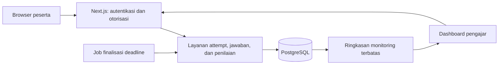

# Analisis Safe Exam Web berbasis Next.js

Tanggal: 23 Oktober 2026  
Status: diperbarui mengikuti keputusan pengguna tentang mode Exam ketat dengan reset jawaban  
Dokumen terkait: [PRD](./PRD.md)

## 1. Kesimpulan

Bangun aplikasi ujian berbasis Next.js dengan server sebagai sumber kebenaran untuk hak akses, batas waktu, jawaban yang diterima, dan nilai. Gunakan referensi sebagai inspirasi alur peserta, bukan sebagai arsitektur keamanan yang langsung disalin.

Nilai utama produk adalah ujian yang tertib, jawaban yang tersimpan dengan jelas, dan hasil yang dapat ditinjau. Pengawasan melalui browser membantu mengurangi kesempatan dan mencatat indikasi masalah; produk tidak boleh menjanjikan bebas kecurangan.

Workspace saat ditinjau masih kosong. Belum ada implementasi aplikasi yang perlu dimigrasikan. Dokumen ini tidak mencakup pembuatan aplikasinya.

## 2. Dasar analisis dan batas pemeriksaan

Sumber yang diperiksa: README, `src/contexts/ExamContext.js`, `src/services/antiCheat.js`, dan `firestore.rules` pada branch `main` repositori publik. Pemeriksaan dilakukan terhadap kode yang dapat dibaca melalui GitHub, bukan audit menyeluruh, pengujian penetrasi, atau uji beban. Demo tidak dijalankan. Branch `main` dapat berubah setelah tanggal peninjauan.

README menjelaskan aplikasi React/Firebase dengan login Google, MCQ acak, batas waktu, pencatatan aktivitas, dan hasil langsung. Klaim 500+ pengguna bersamaan adalah klaim proyek; kapasitas tersebut belum saya validasi. Ini cukup sebagai contoh alur dasar, tetapi belum menjadi bukti kesiapan operasional untuk ujian penting. [Sumber README](https://github.com/manis-sharma/Secure-Online-Exam-System#readme).

## 3. Temuan kode referensi

| Temuan yang terlihat | Implikasi | Keputusan untuk produk baru |
| --- | --- | --- |
| `loadQuestions` membaca dokumen soal termasuk `correctAnswer`; `submitAnswer` menghitung skor di browser. | Kunci dan penilaian berada pada perangkat peserta. | Kunci privat; penilaian di server. |
| `resumeExam` memanggil pemuatan dan pengacakan soal kembali. | Ada risiko urutan berubah saat melanjutkan; belum diuji langsung. | Simpan snapshot dan urutan per attempt. |
| Countdown menggunakan interval browser. | Tampilan waktu tidak boleh menjadi penentu penerimaan jawaban. | Deadline diperiksa server. |

Temuan dan risiko di atas berasal dari [ExamContext.js](https://github.com/manis-sharma/Secure-Online-Exam-System/blob/main/src/contexts/ExamContext.js).

| Temuan yang terlihat | Implikasi | Keputusan untuk produk baru |
| --- | --- | --- |
| Rules mengizinkan pengguna terautentikasi membaca koleksi soal dan profil siswa. | Akses lebih luas daripada kebutuhan satu peserta. | Batasi ke penugasan dan kepemilikan. |
| Pemilik sesi dapat memperbarui dokumen dengan beberapa field identitas dikunci. | Validitas skor/deadline belum ditegakkan rules tersebut. | Mutasi attempt hanya melalui layanan server. |
| Hasil dapat dibuat oleh pemilik lalu tidak dapat diubah. | Write-once tidak membuktikan nilai benar. | Server membentuk hasil secara transaksional. |

Dasar pemeriksaan: [firestore.rules](https://github.com/manis-sharma/Secure-Online-Exam-System/blob/main/firestore.rules). Ini temuan pada aturan dan kode yang dibaca, bukan klaim eksploitasi terhadap deployment aktif.

Lapisan anti-cheat memasang listener visibility, clipboard, shortcut, dan `devtoolschange`. Pada file yang diperiksa, listener DevTools tidak membuktikan deteksi universal. Penghitung inaktivitas juga berjalan di browser. Aktivitas perlu disertai konteks dan penanganan salah deteksi; konsekuensi reset pada produk baru adalah kebijakan yang diminta pengguna. [Sumber antiCheat.js](https://github.com/manis-sharma/Secure-Online-Exam-System/blob/main/src/services/antiCheat.js).

## 4. Makna “safe” yang realistis

Pisahkan tiga sasaran berikut agar pengembangan tidak berhenti pada pemblokiran klik kanan.

| Sasaran | Kontrol yang diusulkan | Batas |
| --- | --- | --- |
| Integritas data | Otorisasi server, kunci privat, transaksi submit, audit perubahan | Tetap membutuhkan pengujian dan operasi yang benar |
| Ketahanan ujian | Autosave, retry idempotent, resume, deadline server | Jawaban belum diterima tidak dijamin tersimpan; jawaban mode ketat dapat sengaja direset sesuai aturan |
| Integritas pelaksanaan | Pengacakan, satu sesi penulis aktif, fullscreen opsional, log aktivitas, review manusia | Telemetri peserta dapat hilang atau dimanipulasi |

Page Visibility API melaporkan halaman terlihat/tersembunyi, bukan alasan pengguna meninggalkan halaman. Timer tab latar belakang juga dapat diperlambat browser. Pindah tab bukan bukti otomatis kecurangan dan countdown lokal bukan otoritas waktu. Pada mode ketat yang dipilih pengguna, `hidden` menjadi pemicu reset berdasarkan tata tertib; minimize/layar mati juga dapat memicunya. Tab lain yang dibuka di latar belakang tanpa menyembunyikan ujian tidak dijamin terdeteksi. [Dokumentasi MDN](https://developer.mozilla.org/en-US/docs/Web/API/Page_Visibility_API).

Pengguna tetap dapat keluar fullscreen. Fullscreen adalah tata cara pelaksanaan yang dapat dipantau, bukan penguncian perangkat. [Panduan Fullscreen API](https://developer.mozilla.org/en-US/docs/Web/API/Fullscreen_API/Guide).

Sebagai batas desain, web biasa tidak menjamin pencegahan screenshot, penggunaan ponsel kedua, bantuan orang lain, atau aplikasi di perangkat lain. Untuk ujian berisiko tinggi, kebutuhan browser khusus/kiosk dan pengawasan operasional perlu dievaluasi terpisah.

## 5. Rekomendasi produk

Mulai dari satu lembaga. Sediakan tiga peran: admin, pengajar/pengawas, dan peserta. Pengajar mengelola ujian miliknya; admin mengatur penugasan. MVP fokus pada MCQ satu jawaban benar, karena bisa dinilai konsisten dan cepat diuji.

Dua preset menggunakan mesin ujian yang sama:

- **Quiz:** navigasi bebas, pengawasan ringan, hasil dapat langsung diterbitkan.
- **Exam ketat:** akses berdasarkan daftar peserta, pengacakan, semua jawaban direset pada kejadian pertama meninggalkan tab yang terdeteksi, hasil ditahan sampai diterbitkan pengajar.

Perbedaan preset berupa konfigurasi yang terlihat sebelum mulai. Untuk MVP, pilih timer total ujian; timer per soal dan larangan kembali ditunda agar pemulihan koneksi dan navigasi lebih sederhana.

Sesuai keputusan pengguna, **satu kejadian `visibility_hidden` langsung mengosongkan seluruh jawaban aktif**, termasuk jawaban yang sudah tersimpan, dan mengembalikan peserta ke soal pertama. Attempt, sisa waktu, dan urutan soal/opsi tetap sama; kejadian berikutnya kembali mereset. Tidak ada pengurangan waktu atau diskualifikasi otomatis. Aturan dan akibatnya ditampilkan sebelum mulai.

Reset harus atomik di server, menaikkan `answer_epoch`, membersihkan pilihan/penanda review serta antrean lokal lama, dan menolak save/submit dari epoch lama. Dengan begitu autosave, respons terlambat, atau refresh tidak memulihkan jawaban sebelum reset. Jika event terjadi saat offline, blokir pengerjaan sampai insiden diproses server. Detail kontrak ada pada FR-05/06/08/09 di PRD.

Reset bergantung pada event yang berhasil dilaporkan. Jika server baru menerima event setelah deadline/finalisasi, hasil final tetap dan insiden ditinjau pengawas; tidak menjanjikan reset server ketika event tidak pernah terkirim. Petugas dapat memberi retake terpisah bila ada salah deteksi, dengan audit. Deadline habis memfinalisasi hanya jawaban aktif pada epoch terakhir.

## 6. Arsitektur yang direkomendasikan

**Pilihan awal:** Next.js App Router + TypeScript, Supabase Auth, PostgreSQL pada Supabase, dan penyimpanan privat untuk media soal bila diperlukan. Pilihan ini mengurangi layanan yang perlu dirakit sambil menyediakan model relasional untuk peserta, kelas, ujian, dan hasil. Ini usulan arsitektur, belum keputusan vendor final.

Server Components dipakai untuk halaman dashboard dan data awal. Client Components menangani runner interaktif, indikator koneksi, serta telemetri. Route Handlers menerima operasi attempt; keduanya menggunakan Data Access Layer server yang sama untuk aturan akses.

Next.js merekomendasikan DAL yang berjalan di server, memeriksa otorisasi, dan mengembalikan DTO minimum. Pengecekan di halaman tidak menggantikan pengecekan pada setiap endpoint/Server Action. [Dokumentasi keamanan Next.js](https://nextjs.org/docs/app/guides/data-security).

Browser peserta tidak membaca tabel ujian secara langsung. Terapkan RLS/privilege database sebagai lapisan tambahan; kunci administratif Supabase hanya di server. Kredensial berhak bypass RLS membuat pemeriksaan akses aplikasi tetap wajib. [Dokumentasi Supabase RLS](https://supabase.com/docs/guides/database/postgres/row-level-security).

Mulai monitoring dengan polling terotorisasi setiap 10 detik. Gunakan realtime hanya jika hasil pengukuran membenarkan kompleksitas dan biayanya. Kehilangan kanal monitoring tidak boleh menggagalkan simpan jawaban.

## 7. Prioritas pembangunan

| Prioritas | Hasil |
| --- | --- |
| P0 | Identitas, role, kelas, bank soal, publikasi versi ujian, penugasan |
| P0 | Attempt persisten, jawaban tanpa kunci, autosave, resume, deadline server, reset atomik dengan epoch |
| P0 | Submit idempotent, penilaian server, rilis hasil, ekspor CSV |
| P0 | Pengawasan dasar, review insiden, audit, uji akses dan beban |
| P1 | Impor soal CSV, timer per soal, esai, analitik lebih dalam |
| P2 | Banyak lembaga/SaaS, integrasi LMS, proctoring kamera, evaluasi browser khusus |

## 8. Risiko terbesar dan cara membuktikan kesiapan

| Risiko | Mitigasi dan bukti yang diperlukan |
| --- | --- |
| Kunci bocor | Inspeksi HTML, RSC, API, media, cache, bundle, dan kanal monitoring peserta |
| Jawaban hilang saat putus koneksi | Status simpan eksplisit, antrean lokal sementara, retry; uji offline dan reconnect |
| Submit ganda atau autosave terlambat | Kunci transaksi per attempt, idempotency, revision; uji balapan request |
| Reset salah sasaran atau berganda | Pemicu hidden eksplisit, aturan sebelum start, ID episode unik, fullscreen tidak mereset sendiri, audit dan review |
| Jawaban lama muncul lagi setelah reset | Epoch server, penolakan request/ACK lama, pembersihan antrean lokal, uji race reset vs autosave/submit |
| Beban meningkat saat mulai/selesai bersama | Uji 500 peserta dan burst submit; ukur p95, error, pool DB, dan biaya |
| Perubahan soal merusak hasil | Versi terbit tidak dapat diubah; snapshot konten, bobot, dan aturan |

Target kapasitas merupakan sasaran pengujian. Estimasi sederhana: 500 peserta dengan heartbeat 30 detik menghasilkan sekitar 17 request/detik; autosave rata-rata satu perubahan per 10 detik menghasilkan 50 request/detik. Ini belum termasuk start, submit, retry, atau dashboard. Gunakan profil beban pada PRD untuk mengukur sistem sebenarnya.

## 9. Langkah lanjut

PRD menetapkan asumsi awal yang bisa langsung dipakai memecah backlog. Sebelum implementasi, konfirmasi jenis lembaga, perangkat peserta, metode login, ukuran ujian, kebijakan retensi, dan kebutuhan penguncian perangkat. Persetujuan terhadap PRD tidak berarti kapasitas dan keamanan sudah terbukti; keduanya menjadi gate peluncuran.
